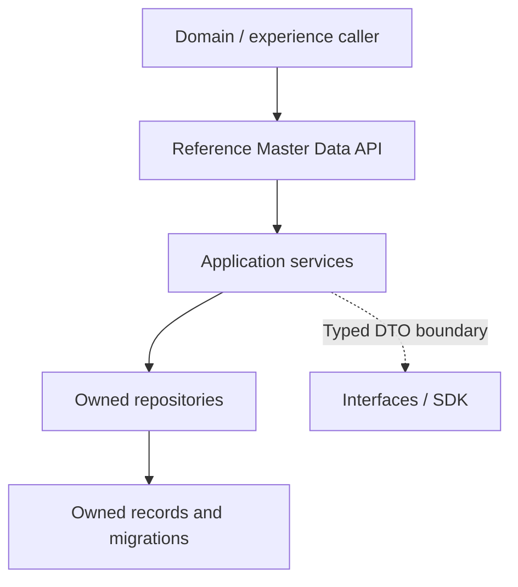

<a href="https://fireflysoftware.io/openplatform/">
<picture>
  <source media="(max-width: 640px) and (prefers-color-scheme: dark)" srcset="https://raw.githubusercontent.com/firefly-oss/.github/main/profile/assets/banner-narrow-dark.svg">
  <source media="(max-width: 640px)" srcset="https://raw.githubusercontent.com/firefly-oss/.github/main/profile/assets/banner-narrow-light.svg">
  <source media="(prefers-color-scheme: dark)" srcset="https://raw.githubusercontent.com/firefly-oss/.github/main/profile/assets/banner-dark.svg">
  
</picture>
</a>

# Reference Master Data

Core data service for shared countries, currencies, classifications, and reference catalogs in Firefly OpenPlatform.

[Platform documentation](https://docs.fireflysoftware.io/) · [Source reference](docs/openplatform/reference.md) · [Source inventory](docs/openplatform/source-inventory.json)

## Purpose, scope, and readiness

Owns countries, currencies, classifications and shared reference catalogs, plus governed document types, localized drafts and immutable published template revisions. Existing source/locale/type identities and exact schema/source digests are retained; configuration bindings and generation remain separate owners. The additive layout API atomically publishes a new localized source and immutable layout/profile/ordered legal-notice associations; it does not adopt a previously committed revision.

The bounded immutable layout publication authority is independently qualified: genuine producer240tests, fresh independent maintained240tests and exact executable/SDK28maintained plus13new assertions. Existing source publication/cache and normal SDK authoring remain separately qualified. Metadata recognition does not establish tenant issuer binding, controlled assets, renderer/PDF output or a complete customer document journey. See docs/document-layout-publications.md.

## Business ownership and supported journeys

Provide stable reference identifiers for financial workflows. For document authoring, use trusted read/draft/publish/resolve/retire permissions, author exact schema JSON and publish an explicit version/locale snapshot through the generated SDK. See [the complete template revision tutorial](docs/document-template-revisions.md). The [sandbox stationery catalog](sandbox/documents/README.md) supplies substantive schemas, reconciled fictional facts and controlled offline Firefly print designs; its PDF previews are not a service output profile.

Reference data does not own products, parties, contracts, or customer permissions. A catalog entry describes a value; it does not implement a business decision.

| Entry point | Declared operations |
| --- | --- |
| [ActivityCodeController](core-common-reference-master-data-web/src/main/java/io/fireflysoftware/masters/web/controllers/activity/v1/ActivityCodeController.java) | `GET /api/v1/activity-codes`; `GET /api/v1/activity-codes/country/{countryId}`; `GET /api/v1/activity-codes/parent/{parentCodeId}`; 4 more declarations |
| [AssetTypeController](core-common-reference-master-data-web/src/main/java/io/fireflysoftware/masters/web/controllers/assettype/v1/AssetTypeController.java) | `GET /api/v1/asset-types`; `GET /api/v1/asset-types/{assetId}`; `POST /api/v1/asset-types`; 2 more declarations |
| [BankInstitutionCodeController](core-common-reference-master-data-web/src/main/java/io/fireflysoftware/masters/web/controllers/bank/v1/BankInstitutionCodeController.java) | `GET /api/v1/bank-institution-codes`; `GET /api/v1/bank-institution-codes/{id}`; `POST /api/v1/bank-institution-codes`; 2 more declarations |
| [ConsentCatalogController](core-common-reference-master-data-web/src/main/java/io/fireflysoftware/masters/web/controllers/consent/v1/ConsentCatalogController.java) | `GET /api/v1/consent-catalog`; `GET /api/v1/consent-catalog/type/{consentType}`; `GET /api/v1/consent-catalog/{id}`; 3 more declarations |
| [ContractDocumentTypeController](core-common-reference-master-data-web/src/main/java/io/fireflysoftware/masters/web/controllers/contractdocumenttype/v1/ContractDocumentTypeController.java) | `GET /api/v1/contract-document-types`; `GET /api/v1/contract-document-types/{documentTypeId}`; `GET /api/v1/contract-document-types/by-code/{documentCode}`; 3 more declarations |
| [ContractRoleController](core-common-reference-master-data-web/src/main/java/io/fireflysoftware/masters/web/controllers/contractrole/v1/ContractRoleController.java) | `GET /api/v1/contract-roles/{roleId}`; `POST /api/v1/contract-roles/filter`; `POST /api/v1/contract-roles`; 2 more declarations |
| [ContractRoleScopeController](core-common-reference-master-data-web/src/main/java/io/fireflysoftware/masters/web/controllers/contractrole/v1/ContractRoleScopeController.java) | `GET /api/v1/contract-role-scopes/{scopeId}`; `GET /api/v1/contract-role-scopes/role/{roleId}`; `GET /api/v1/contract-role-scopes/role/{roleId}/active`; 4 more declarations |
| [ContractTypeController](core-common-reference-master-data-web/src/main/java/io/fireflysoftware/masters/web/controllers/contracttype/v1/ContractTypeController.java) | `GET /api/v1/contract-types`; `GET /api/v1/contract-types/{contractId}`; `POST /api/v1/contract-types`; 2 more declarations |
| [CountryController](core-common-reference-master-data-web/src/main/java/io/fireflysoftware/masters/web/controllers/country/v1/CountryController.java) | `GET /api/v1/countries/{countryId}`; `POST /api/v1/countries/filter`; `POST /api/v1/countries`; 2 more declarations |
| [CurrencyExecutionPolicyController](core-common-reference-master-data-web/src/main/java/io/fireflysoftware/masters/web/controllers/currency/policy/v1/CurrencyExecutionPolicyController.java) | `GET /api/v1/currency-execution-policies/currencies/{currencyId}/source-observation`; `GET /api/v1/currency-execution-policies/{policyId}`; `GET /api/v1/currency-execution-policies/by-action/{actionId}`; 2 more declarations |
| [CurrencyController](core-common-reference-master-data-web/src/main/java/io/fireflysoftware/masters/web/controllers/currency/v1/CurrencyController.java) | `GET /api/v1/currencies/{currencyId}`; `POST /api/v1/currencies/filter`; `POST /api/v1/currencies`; 2 more declarations |
| [AdministrativeDivisionController](core-common-reference-master-data-web/src/main/java/io/fireflysoftware/masters/web/controllers/division/v1/AdministrativeDivisionController.java) | `GET /api/v1/divisions`; `GET /api/v1/divisions/{divisionId}`; `POST /api/v1/divisions`; 2 more declarations |
| [DocumentLayoutPublicationController](core-common-reference-master-data-web/src/main/java/io/fireflysoftware/masters/web/controllers/document/layout/v1/DocumentLayoutPublicationController.java) | `GET /api/v1/document-layout-publications/templates/{templateId}/source-observation`; `GET /api/v1/document-layout-publications/{layoutRevisionId}`; `GET /api/v1/document-layout-publications/resolve`; 2 more declarations |
| [DocumentTemplateCatalogController](core-common-reference-master-data-web/src/main/java/io/fireflysoftware/masters/web/controllers/document/v1/DocumentTemplateCatalogController.java) | `GET /api/v1/document-templates`; `GET /api/v1/document-templates/category/{category}`; `GET /api/v1/document-templates/type/{typeId}`; 5 more declarations |
| [DocumentTemplateLocalizationController](core-common-reference-master-data-web/src/main/java/io/fireflysoftware/masters/web/controllers/document/v1/DocumentTemplateLocalizationController.java) | `GET /api/v1/document-template-localizations/template/{templateId}`; `GET /api/v1/document-template-localizations/locale/{localeId}`; `GET /api/v1/document-template-localizations/{localizationId}`; 5 more declarations |
| [DocumentTemplateRevisionController](core-common-reference-master-data-web/src/main/java/io/fireflysoftware/masters/web/controllers/document/v1/DocumentTemplateRevisionController.java) | `GET /api/v1/document-template-revisions/{revisionId}`; `GET /api/v1/document-template-revisions/resolve`; `POST /api/v1/document-template-revisions/templates/{templateId}/publish`; 1 more declarations |
| [DocumentTemplateTypeCatalogController](core-common-reference-master-data-web/src/main/java/io/fireflysoftware/masters/web/controllers/document/v1/DocumentTemplateTypeCatalogController.java) | `GET /api/v1/document-template-types`; `GET /api/v1/document-template-types/{typeId}`; `GET /api/v1/document-template-types/code/{typeCode}`; 3 more declarations |
| [IdentityDocumentCatalogController](core-common-reference-master-data-web/src/main/java/io/fireflysoftware/masters/web/controllers/identitydocument/v1/IdentityDocumentCatalogController.java) | `GET /api/v1/identity-documents`; `GET /api/v1/identity-documents/category/{categoryId}`; `GET /api/v1/identity-documents/country/{countryId}`; 5 more declarations |
| [IdentityDocumentCategoryCatalogController](core-common-reference-master-data-web/src/main/java/io/fireflysoftware/masters/web/controllers/identitydocument/v1/IdentityDocumentCategoryCatalogController.java) | `GET /api/v1/identity-document-categories`; `GET /api/v1/identity-document-categories/{categoryId}`; `GET /api/v1/identity-document-categories/code/{categoryCode}`; 3 more declarations |
| [IdentityDocumentLocalizationController](core-common-reference-master-data-web/src/main/java/io/fireflysoftware/masters/web/controllers/identitydocument/v1/IdentityDocumentLocalizationController.java) | `GET /api/v1/identity-document-localizations`; `GET /api/v1/identity-document-localizations/document/{documentId}`; `GET /api/v1/identity-document-localizations/document/{documentId}/locale/{localeId}`; 4 more declarations |
| [LegalFormController](core-common-reference-master-data-web/src/main/java/io/fireflysoftware/masters/web/controllers/legal/v1/LegalFormController.java) | `GET /api/v1/legal-forms/country/{countryId}`; `GET /api/v1/legal-forms/{legalFormId}`; `POST /api/v1/legal-forms/filter`; 3 more declarations |
| [LanguageLocaleController](core-common-reference-master-data-web/src/main/java/io/fireflysoftware/masters/web/controllers/locale/v1/LanguageLocaleController.java) | `GET /api/v1/language-locales`; `GET /api/v1/language-locales/{id}`; `POST /api/v1/language-locales`; 2 more declarations |
| [LookupDomainController](core-common-reference-master-data-web/src/main/java/io/fireflysoftware/masters/web/controllers/lookup/v1/LookupDomainController.java) | `GET /api/v1/lookup/domains`; `GET /api/v1/lookup/domains/{domainId}`; `POST /api/v1/lookup/domains`; 2 more declarations |
| [LookupItemController](core-common-reference-master-data-web/src/main/java/io/fireflysoftware/masters/web/controllers/lookup/v1/LookupItemController.java) | `GET /api/v1/lookup/items`; `GET /api/v1/lookup/items/domain/{domainId}`; `GET /api/v1/lookup/items/{itemId}`; 3 more declarations |
| [MessageTypeCatalogController](core-common-reference-master-data-web/src/main/java/io/fireflysoftware/masters/web/controllers/notification/v1/MessageTypeCatalogController.java) | `GET /api/v1/message-types`; `GET /api/v1/message-types/{typeId}`; `GET /api/v1/message-types/code/{typeCode}`; 3 more declarations |
| [NotificationMessageCatalogController](core-common-reference-master-data-web/src/main/java/io/fireflysoftware/masters/web/controllers/notification/v1/NotificationMessageCatalogController.java) | `GET /api/v1/notification-messages`; `GET /api/v1/notification-messages/event-type/{eventType}`; `GET /api/v1/notification-messages/message-type/{typeId}`; 5 more declarations |
| [NotificationMessageLocalizationController](core-common-reference-master-data-web/src/main/java/io/fireflysoftware/masters/web/controllers/notification/v1/NotificationMessageLocalizationController.java) | `GET /api/v1/notification-localizations/message/{messageId}`; `GET /api/v1/notification-localizations/locale/{localeId}`; `GET /api/v1/notification-localizations/{localizationId}`; 5 more declarations |
| [NotificationMessageTemplateController](core-common-reference-master-data-web/src/main/java/io/fireflysoftware/masters/web/controllers/notification/v1/NotificationMessageTemplateController.java) | `GET /api/v1/notification-templates`; `GET /api/v1/notification-templates/type/{templateType}`; `GET /api/v1/notification-templates/message/{messageId}`; 6 more declarations |
| [RelationshipTypeMasterController](core-common-reference-master-data-web/src/main/java/io/fireflysoftware/masters/web/controllers/relationships/v1/RelationshipTypeMasterController.java) | `GET /api/v1/relationship-types`; `GET /api/v1/relationship-types/{relationshipTypeId}`; `POST /api/v1/relationship-types`; 2 more declarations |
| [RuleOperationTypeController](core-common-reference-master-data-web/src/main/java/io/fireflysoftware/masters/web/controllers/ruleoperationtype/v1/RuleOperationTypeController.java) | `GET /api/v1/rule-operation-types/{operationTypeId}`; `POST /api/v1/rule-operation-types/filter`; `POST /api/v1/rule-operation-types`; 2 more declarations |
| [TitleMasterController](core-common-reference-master-data-web/src/main/java/io/fireflysoftware/masters/web/controllers/title/v1/TitleMasterController.java) | `GET /api/v1/titles`; `GET /api/v1/titles/{titleId}`; `POST /api/v1/titles`; 2 more declarations |
| [TransactionCategoryCatalogController](core-common-reference-master-data-web/src/main/java/io/fireflysoftware/masters/web/controllers/transaction/v1/TransactionCategoryCatalogController.java) | `GET /api/v1/transaction-categories`; `GET /api/v1/transaction-categories/root`; `GET /api/v1/transaction-categories/parent/{parentCategoryId}`; 5 more declarations |
| [TransactionCategoryLocalizationController](core-common-reference-master-data-web/src/main/java/io/fireflysoftware/masters/web/controllers/transaction/v1/TransactionCategoryLocalizationController.java) | `GET /api/v1/transaction-category-localizations/category/{categoryId}`; `GET /api/v1/transaction-category-localizations/category/{categoryId}/paginated`; `GET /api/v1/transaction-category-localizations/{localizationId}`; 4 more declarations |

The complete [operation reference](docs/openplatform/reference.md#http-operations) lists each mapping and its owning method. These are source declarations; conditional beans, inherited controllers, security filters, and deployment routing can change the effective runtime API.

## Consumer example: page activity-code master data

Start with this repository-owned executable contract before connecting a full runtime. Use the JDK required by the effective parent, Maven, and the matching internal artifacts. The selected test defines its own collaborators; no provider credentials should be added to it. Run from this repository root:

```sh
mvn -B -pl core-common-reference-master-data-core -am test -DskipOpenApiGen \
  -Dtest=ActivityCodeServiceImplTest -Dsurefire.failIfNoSpecifiedTests=false
```

Runtime integration remains gated on the service configuration and selected adapters described below. The local port and bean-selection inventory below distinguishes the declared abstraction from its configured implementation. An SDK client is an outbound integration; its presence does not establish a working provider connection. Where a sandbox adapter is selected, its behavior is synthetic and limited to what that adapter implements.

**Inputs and fixture ownership.** The complete linked test class supplies its imports, setup, synthetic IDs and collaborators. Run that class as shown; the excerpt is not a standalone Java program. Mocked collaborators include `ActivityCodeRepository`, `ActivityCodeMapper`. For a deployed call, replace fixture IDs with IDs returned by the owning record-creation API and keep tenant/parent associations intact. The request values and assertions below describe this test boundary only.

```java
@BeforeEach
    void setUp() {
        // Setup test data
        testActivityCodeId = UUID.randomUUID();
        testCountryId = UUID.randomUUID();

        entity = new ActivityCode();
        entity.setActivityCodeId(testActivityCodeId);
        entity.setCountryId(testCountryId);
        entity.setCode("A01");
        entity.setClassificationSys("NAICS");
        entity.setDescription("Crop Production");
        entity.setParentCodeId(null);
        entity.setHighRisk(false);
        entity.setRiskFactors(null);
        entity.setStatus(StatusEnum.ACTIVE);
        entity.setDateCreated(LocalDateTime.now());
        entity.setDateUpdated(LocalDateTime.now());

        dto = new ActivityCodeDTO();
        dto.setActivityCodeId(testActivityCodeId);
        dto.setCountryId(testCountryId);
        dto.setCode("A01");
        dto.setClassificationSys("NAICS");
        dto.setDescription("Crop Production");
        dto.setParentCodeId(null);
        dto.setHighRisk(false);
        dto.setRiskFactors(null);
        dto.setStatus(StatusEnum.ACTIVE);

        paginationRequest = new TestPaginationRequest(0, 10);
    }

@Test
    void listActivityCodes_ShouldReturnPaginatedResponse() {
        // Arrange
        Pageable pageable = paginationRequest.toPageable();
        when(repository.findAllBy(any(Pageable.class))).thenReturn(Flux.just(entity));
        when(repository.count()).thenReturn(Mono.just(1L));
        when(mapper.toDTO(any(ActivityCode.class))).thenReturn(dto);

        // Act
        Mono<PaginationResponse<ActivityCodeDTO>> result = service.listActivityCodes(paginationRequest);

        // Assert
        StepVerifier.create(result)
                .expectNextMatches(response -> {
                    return response.getContent().size() == 1 &&
                            response.getContent().get(0).getActivityCodeId().equals(testActivityCodeId) &&
                            response.getTotalElements() == 1L;
                })
                .verifyComplete();

        verify(repository).findAllBy(any(Pageable.class));
        verify(repository).count();
        verify(mapper).toDTO(any(ActivityCode.class));
    }
```

**Expected behavior.** The result contains one activity-code DTO and totalElements=1. Pagination totals and content are both asserted.

**Verification and recovery.** Run the complete selected test class and inspect its Surefire result: zero failures/errors and at least one executed test are required. A skipped or zero-test build is not evidence. Compare the assertions with the owning DTO/service before extending the request. For a runtime run, separately configure authentication/entitlements and the exact downstream endpoints, migrate/seed disposable owner stores, and reread the returned identifier; these unit/contract fixtures do not establish those prerequisites.

**Execution evidence.** Source checked against the linked test and local declarations. The documentation worker has not run this repository test or the full service. The excerpt is retained from the existing test; mock, in-memory, or local HTTP fixture results are not live-provider acceptance.

Source of this example: [ActivityCodeServiceImplTest](core-common-reference-master-data-core/src/test/java/io/fireflysoftware/masters/core/services/activity/v1/ActivityCodeServiceImplTest.java), [ActivityCodeMapper](core-common-reference-master-data-core/src/main/java/io/fireflysoftware/masters/core/mappers/activity/v1/ActivityCodeMapper.java), [ActivityCodeDTO](core-common-reference-master-data-interfaces/src/main/java/io/fireflysoftware/masters/interfaces/dtos/activity/v1/ActivityCodeDTO.java), [StatusEnum](core-common-reference-master-data-interfaces/src/main/java/io/fireflysoftware/masters/interfaces/enums/commons/v1/StatusEnum.java), [ActivityCode](core-common-reference-master-data-models/src/main/java/io/fireflysoftware/masters/models/entities/activity/v1/ActivityCode.java), [ActivityCodeRepository](core-common-reference-master-data-models/src/main/java/io/fireflysoftware/masters/models/repositories/activity/v1/ActivityCodeRepository.java).

## Architecture and repository layout



| Module | Responsibility |
| --- | --- |
| [core-common-reference-master-data-core](core-common-reference-master-data-core/) | Application services, handlers, and business coordination; inspect these implementations for lifecycle rules. |
| [core-common-reference-master-data-models](core-common-reference-master-data-models/) | Persisted entities, repositories, and database migrations; this is the data ownership boundary. |
| [core-common-reference-master-data-interfaces](core-common-reference-master-data-interfaces/) | Public DTOs, commands, queries, and contracts shared across the module boundary. |
| [core-common-reference-master-data-web](core-common-reference-master-data-web/) | HTTP entry points, boot application, and runtime configuration. |
| [core-common-reference-master-data-sdk](core-common-reference-master-data-sdk/) | Client artifact and OpenAPI generation configuration; build it from the matching service contract. |

## Contracts, data, authentication, and errors

Use typed master-data operations and matching generated SDKs. Document-template authoring provides inputSchemaJson for exact numeric transport; choose one authoring representation explicitly. Published revisions preserve canonical strings/digests, resolve exact tuples without fallback and retain historical content after retirement. Read [the publication and SDK guide](docs/document-template-revisions.md) before integrating generation.

| Data type | Declared fields (selection) |
| --- | --- |
| [ActivityCode](core-common-reference-master-data-models/src/main/java/io/fireflysoftware/masters/models/entities/activity/v1/ActivityCode.java) | `activityCodeId`, `countryId`, `code`, `classificationSys`, `description`, `parentCodeId`, `highRisk` |
| [AssetType](core-common-reference-master-data-models/src/main/java/io/fireflysoftware/masters/models/entities/assettype/v1/AssetType.java) | `assetId`, `assetCode`, `description`, `name`, `isActive`, `dateCreated`, `dateUpdated` |
| [BankInstitutionCode](core-common-reference-master-data-models/src/main/java/io/fireflysoftware/masters/models/entities/bank/v1/BankInstitutionCode.java) | `institutionId`, `bankName`, `swiftCode`, `routingNumber`, `ibanPrefix`, `countryId`, `institutionTypeLkpId` |
| [ConsentCatalog](core-common-reference-master-data-models/src/main/java/io/fireflysoftware/masters/models/entities/consent/v1/ConsentCatalog.java) | `consentId`, `consentType`, `consentDescription`, `expiryPeriodDays`, `consentVersion`, `consentSource`, `status` |
| [ContractDocumentType](core-common-reference-master-data-models/src/main/java/io/fireflysoftware/masters/models/entities/contractdocumenttype/v1/ContractDocumentType.java) | `documentTypeId`, `documentCode`, `name`, `description`, `isActive`, `dateCreated`, `dateUpdated` |
| [ContractRole](core-common-reference-master-data-models/src/main/java/io/fireflysoftware/masters/models/entities/contractrole/v1/ContractRole.java) | `roleId`, `roleCode`, `description`, `name`, `isActive`, `dateCreated`, `dateUpdated` |
| [ContractRoleScope](core-common-reference-master-data-models/src/main/java/io/fireflysoftware/masters/models/entities/contractrole/v1/ContractRoleScope.java) | `scopeId`, `roleId`, `scopeCode`, `scopeName`, `description`, `actionType`, `resourceType` |
| [ContractType](core-common-reference-master-data-models/src/main/java/io/fireflysoftware/masters/models/entities/contracttype/v1/ContractType.java) | `contractId`, `contractCode`, `description`, `name`, `isActive`, `dateCreated`, `dateUpdated` |
| [Country](core-common-reference-master-data-models/src/main/java/io/fireflysoftware/masters/models/entities/country/v1/Country.java) | `countryId`, `isoCode`, `countryName`, `region`, `status`, `svgFlag`, `dateCreated` |
| [Currency](core-common-reference-master-data-models/src/main/java/io/fireflysoftware/masters/models/entities/currency/v1/Currency.java) | `currencyId`, `isoCode`, `currencyName`, `symbol`, `decimalPrecision`, `isMajor`, `status` |
| [AdministrativeDivision](core-common-reference-master-data-models/src/main/java/io/fireflysoftware/masters/models/entities/division/v1/AdministrativeDivision.java) | `divisionId`, `countryId`, `code`, `name`, `level`, `parentDivisionId`, `status` |
| [DocumentTemplateCatalog](core-common-reference-master-data-models/src/main/java/io/fireflysoftware/masters/models/entities/document/v1/DocumentTemplateCatalog.java) | `templateId`, `templateCode`, `typeId`, `category`, `description`, `templateName`, `templateContent` |

The [data contract reference](docs/openplatform/reference.md#data-contracts) indexes **81 DTO, record, or entity declarations** and their fields. Read DTO validation annotations together with service logic and migrations; a field's presence does not establish that every endpoint accepts it.

Use the authentication and authorization behavior actually enforced by the deployed entry point. Tenant, party, distributor, and staff identifiers carry business scope; they must not be accepted as proof of identity. Preserve validation and downstream errors rather than mapping an unavailable dependency to a successful business result.

Examples of locally enforced failure or access behavior:

| Declared check or failure | Implementation |
| --- | --- |
| `new RuntimeException("Error converting template variables JSON to Map", e);` | [NotificationMessageTemplateMapper](core-common-reference-master-data-core/src/main/java/io/fireflysoftware/masters/core/mappers/notification/v1/NotificationMessageTemplateMapper.java) |
| `new RuntimeException("Error converting template variables Map to JSON", e);` | [NotificationMessageTemplateMapper](core-common-reference-master-data-core/src/main/java/io/fireflysoftware/masters/core/mappers/notification/v1/NotificationMessageTemplateMapper.java) |
| `new RuntimeException("Error converting parameters JSON to Map", e);` | [NotificationMessageCatalogMapper](core-common-reference-master-data-core/src/main/java/io/fireflysoftware/masters/core/mappers/notification/v1/NotificationMessageCatalogMapper.java) |
| `new RuntimeException("Error converting parameters Map to JSON", e);` | [NotificationMessageCatalogMapper](core-common-reference-master-data-core/src/main/java/io/fireflysoftware/masters/core/mappers/notification/v1/NotificationMessageCatalogMapper.java) |
| `new ResponseStatusException(` | [DocumentLayoutPublicationService](core-common-reference-master-data-core/src/main/java/io/fireflysoftware/masters/core/services/document/v1/DocumentLayoutPublicationService.java) |
| `new IllegalStateException(` | [DocumentLayoutRepository](core-common-reference-master-data-models/src/main/java/io/fireflysoftware/masters/models/repositories/document/layout/v1/DocumentLayoutRepository.java) |

The [security and failure reference](docs/openplatform/reference.md#security-and-failure-evidence) links local authorization annotations, status mappings, and exception sites. Framework or gateway policy is additional to this local inventory; verify the deployed filter chain and caller entitlements before integration.

## External dependencies, sandbox behavior, and replacement

The local port and bean-selection inventory below distinguishes the declared abstraction from its configured implementation. An SDK client is an outbound integration; its presence does not establish a working provider connection. Where a sandbox adapter is selected, its behavior is synthetic and limited to what that adapter implements.

For a project-specific provider, implement the existing typed boundary and select it through the repository wiring. Preserve the caller-visible validation, lifecycle, error, correlation, and retry semantics; verify both successful and failed requests against the same contract. Supply endpoint/credentials through configuration. If no sandbox selector is listed, do not invent one or silently introduce sample success as a fallback.

## Configuration and local setup

Runtime configuration sources: [DocumentLayoutProfileConfiguration.java](core-common-reference-master-data-core/src/main/java/io/fireflysoftware/masters/core/services/document/layout/v1/DocumentLayoutProfileConfiguration.java), [openapi.yml](core-common-reference-master-data-sdk/src/main/resources/api-spec/openapi.yml), [openapi.yml](core-common-reference-master-data-sdk/src/main/resources/openapi.yml), [MasterDataApplication.java](core-common-reference-master-data-web/src/main/java/io/fireflysoftware/masters/web/MasterDataApplication.java), [application.yaml](core-common-reference-master-data-web/src/main/resources/application.yaml).

| Environment variable or property | Declared fallback |
| --- | --- |
| `DB_HOST` | `localhost` |
| `DB_PORT` | `5432` |
| `DB_NAME` | `postgres` |
| `DB_USERNAME` | `postgres` |
| `DB_PASSWORD` | `[redacted]` |
| `DB_SSL_MODE` | `disable` |
| `spring.application.name` | Required by this expression |
| `spring.application.version` | Required by this expression |
| `spring.application.description` | Required by this expression |
| `spring.application.team.name` | Required by this expression |
| `spring.application.team.email` | Required by this expression |
| `DB_HOST` | Required by this expression |
| `DB_PORT` | Required by this expression |
| `DB_NAME` | Required by this expression |
| `DB_SSL_MODE` | Required by this expression |
| `DB_USERNAME` | Required by this expression |
| `DB_PASSWORD` | Required by this expression |
| `SERVER_ADDRESS` | `localhost` |
| `SERVER_PORT` | `8080` |

See the [complete configuration reference](docs/openplatform/reference.md#configuration) for every placeholder and its source, including differences between profiles. A fallback is a code default, not a deployment recommendation. Secret defaults are redacted.

Build coordinates: `io.fireflysoftware:core-common-reference-master-data:26.10.6`. Parent: `io.fireflysoftware:firefly-parent:26.10.6`. The POM is the compatibility source of truth.

Use the CI-declared JDK `25` and Maven available on your path. This root POM declares `java.version` / compiler release `25`; a lower source target does not lower the JDK needed to consume framework dependencies. Resolve the parent/BOM and internal SDK artifacts before launching a child module. The framework baseline comes through `firefly-parent`; provider adapters should use the corresponding Jafly modules instead of duplicating framework infrastructure.

```sh
mvn --version
mvn -B verify
```

`verify` compiles the reactor and executes the checks bound by the effective POM. A successful dependency resolution or skipped-test package is not a test result. SDK generation may require a running API specification endpoint; inspect the SDK POM before selecting its generation profile.

The current OpenPlatform parent enables `generate-openapi` when `skipOpenApiGen` is absent. Applicable web modules start an OpenAPI generation application on port **18080**, fetch `/v3/api-docs.yaml`, and stop it during the integration-test lifecycle. To validate code against the checked-in API specification without that application-startup step, use:

```sh
mvn -B verify -DskipOpenApiGen
```

This switch does not skip tests or the SDK module's own source generation. It does omit fresh application-generated OpenAPI evidence; run the complete configured lifecycle when qualifying an API change.

After dependencies and configuration are ready, build/install reactor artifacts and launch the web module:

```sh
mvn -B install
mvn -pl core-common-reference-master-data-web spring-boot:run
```

Run against disposable local infrastructure first. Supply endpoint/database variables from the configuration reference; a default localhost URL does not start that dependency.

Locally declared build plugins: `maven-compiler-plugin`, `maven-failsafe-plugin`, `maven-resources-plugin`, `openapi-generator-maven-plugin`, `spring-boot-maven-plugin`. Inherited checks remain governed by the parent POM.

The checkout contains **44 test source/resource files**. See the [test source index](docs/openplatform/reference.md#test-sources) for coverage locations. This inventory is not evidence that those tests passed.

CI definitions: [maven-central.yml](.github/workflows/maven-central.yml), [release.yml](.github/workflows/release.yml).

## Operations and recovery

On failure, retain the request and business record identifiers, inspect the owning controller/service and downstream status, then verify the current persisted state before retrying. Distinguish invalid input, denied access, missing records, and unavailable infrastructure. Avoid replaying a financial or externally visible action until its prior effect is known. For persistent modules, review the migration history and use the deployment rollback procedure; do not erase records to recover a failed request.

Database evolution is represented by 31 migration files in [core-common-reference-master-data-models/src/main/resources/db/migration](core-common-reference-master-data-models/src/main/resources/db/migration/). Review the last applied migration and the owning entity before diagnosing a schema mismatch.

Existing test scenarios provide concrete starting points for failure reproduction:

- `findByDocumentId_ShouldReturnLocalizations` — [README](core-common-reference-master-data-core/src/test/java/io/fireflysoftware/masters/core/README.md)
- `findByDocumentId_ShouldReturnLocalizations` — [IdentityDocumentLocalizationRepositoryTest](core-common-reference-master-data-core/src/test/java/io/fireflysoftware/masters/core/repositories/identitydocument/v1/IdentityDocumentLocalizationRepositoryTest.java)
- `countByDocumentId_ShouldReturnCount` — [IdentityDocumentLocalizationRepositoryTest](core-common-reference-master-data-core/src/test/java/io/fireflysoftware/masters/core/repositories/identitydocument/v1/IdentityDocumentLocalizationRepositoryTest.java)
- `findByDocumentIdAndLocaleId_ShouldReturnLocalization_WhenFound` — [IdentityDocumentLocalizationRepositoryTest](core-common-reference-master-data-core/src/test/java/io/fireflysoftware/masters/core/repositories/identitydocument/v1/IdentityDocumentLocalizationRepositoryTest.java)
- `findByDocumentIdAndLocaleId_ShouldReturnEmpty_WhenNotFound` — [IdentityDocumentLocalizationRepositoryTest](core-common-reference-master-data-core/src/test/java/io/fireflysoftware/masters/core/repositories/identitydocument/v1/IdentityDocumentLocalizationRepositoryTest.java)
- `deleteByDocumentId_ShouldDeleteLocalizations` — [IdentityDocumentLocalizationRepositoryTest](core-common-reference-master-data-core/src/test/java/io/fireflysoftware/masters/core/repositories/identitydocument/v1/IdentityDocumentLocalizationRepositoryTest.java)
- `listActivityCodes_ShouldReturnPaginatedResponse` — [ActivityCodeServiceImplTest](core-common-reference-master-data-core/src/test/java/io/fireflysoftware/masters/core/services/activity/v1/ActivityCodeServiceImplTest.java)
- `getActivityCodesByCountry_ShouldReturnActivityCodes` — [ActivityCodeServiceImplTest](core-common-reference-master-data-core/src/test/java/io/fireflysoftware/masters/core/services/activity/v1/ActivityCodeServiceImplTest.java)

## Compatibility and validation boundaries

The five additive DocumentLayoutPublicationsApi operations retain all732existing intermediate SDK classes and all692previous classes byte-identical. The layout route creates a genuinely new source and its association in one transaction, rejects committed-source adoption, and uses native body actionId with current policy. Historical read/replay/retire retain profile metadata after registry withdrawal. Existing revision/catalog signatures remain available.

Platform and framework coordinates are enumerated in the [build reference](docs/openplatform/reference.md#build-and-dependencies). Keep the API/SDK and parent/BOM release line aligned; an omitted dependency version is managed upstream, not independently pinned here.

Documentation generation checks source freshness and local references. It does not certify compilation, test success, database migration safety, provider connectivity, regulatory approval, or end-to-end customer acceptance.

## Further reading, contribution, and license

- [Currency execution policy publications](docs/currency-execution-policies.md)
- [Publish document layouts and legal-notice associations](docs/document-layout-publications.md)
- [Immutable document template revisions](docs/document-template-revisions.md)
- [Sandbox financial stationery](sandbox/documents/README.md)

Contributions should describe the affected business contract, update its tests and documentation together, and include the configured verification results. Review the source reference before changing public types or dependency boundaries.

Use is governed by the repository [license](LICENSE).

<!-- Maintained by .github/scripts/documentation/generate.py and curated.json. Edit editorial inputs, then regenerate. -->
